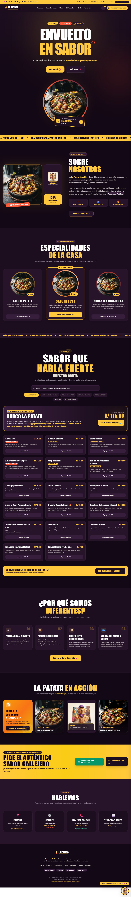

# 🍟 LA PATATA | Street Food Trujillo

> **Papas con Actitud** — Las verdaderas protagonistas.

Plataforma web oficial interactiva para **LA PATATA Street Food**, ubicada en Trujillo, Perú. Especialistas en salchipapas artesanales, pollo broaster marinado, alitas crocantes, combos monumentales y cremas caseras.



---

## 🚀 Características Principales

- **Hero Dinámico:** Showcase del plato estrella con rotación visual y adición rápida al pedido.
- **Marquesinas Callejeras:** Tickers animados con identidad urbana y lemas oficiales.
- **Especialidades de la Casa:** Exhibición de *Salchi Patata*, *Salchi Fest XL* y *Broaster Clásico XL*.
- **Experiencia Monumental:** Banner del *Barco La Patata (~60 cm)* para grupos y eventos.
- **Carta Gastronómica con Filtros y Buscador:**
  - Búsqueda en tiempo real de cualquier producto, ingrediente o salsa.
  - Filtros por categoría: *★ Lo Más Pedido*, *Salchipapas & Bowls*, *Pollo Broaster*, *Alitas & Crunch*, *Boxes & Barco*, *Bebidas*, *Toda la Carta*.
- **Carrito de Pedidos y Checkout por WhatsApp:**
  - Control dinámico de cantidades y cálculo en vivo del subtotal.
  - Campos opcionales para nombre de cliente, dirección de entrega en Trujillo e indicaciones especiales.
  - Generación de mensaje estructurado enviado directamente al WhatsApp del restaurante (+51 970 743 356).
- **Asistente Virtual "Hércules":**
  - Widget flotante interactivo con diálogo asistido de la mascota oficial.
  - Preguntas frecuentes rápidas (Promos, Más pedido, Horarios/Ubicación y Delivery).
- **Diseño Responsive & Dark Editorial Gastronomy:** Optimizado para móviles, tablets y escritorio siguiendo las especificaciones del sistema de diseño.

---

## 🛠️ Tecnologías

- **Framework:** [React 19](https://react.dev/)
- **Bundler:** [Vite](https://vitejs.dev/)
- **Estilos:** [Tailwind CSS v3](https://tailwindcss.com/)
- **Tipografías:** *Anton*, *DM Sans*, *Space Grotesk*, *Epilogue*, *Hanken Grotesk*
- **Despliegue Continuo:** GitHub Actions & GitHub Pages

---

## 💻 Instalación y Desarrollo Local

1. **Clonar el repositorio:**
   ```bash
   git clone https://github.com/Ihan243/Hamburger.git
   cd Hamburger
   ```

2. **Instalar dependencias:**
   ```bash
   npm install
   ```

3. **Ejecutar servidor de desarrollo:**
   ```bash
   npm run dev
   ```

4. **Compilar para producción:**
   ```bash
   npm run build
   ```

5. **Previsualizar el build:**
   ```bash
   npm run preview
   ```

---

## 📍 Ubicación y Horarios

- **Dirección:** San Andrés 5ta Etapa Mz "S" lote 10, Trujillo, Perú
- **Horario:** Miércoles a Lunes de 6:00 PM a 1:00 AM (Martes cerrado)
- **WhatsApp:** [+51 970 743 356](https://wa.me/51970743356)
- **Instagram:** [@lapatataa.pe](https://www.instagram.com/lapatataa.pe/)

---

© 2026 LA PATATA Street Food. Todos los derechos reservados.
